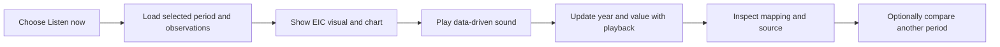
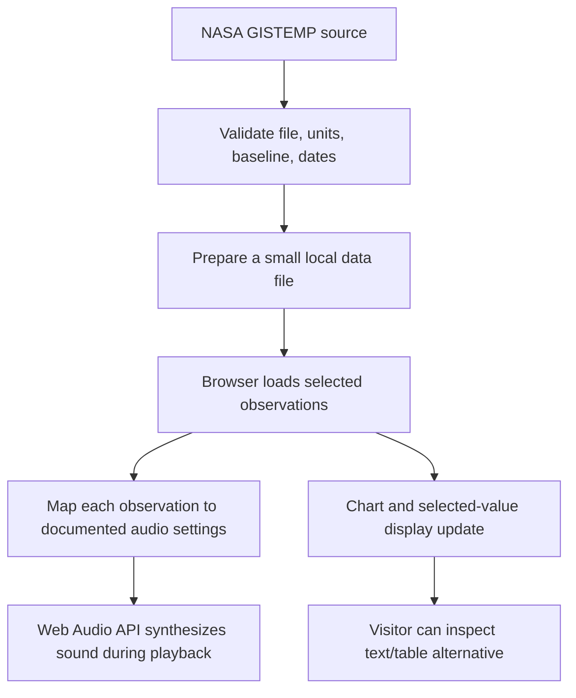
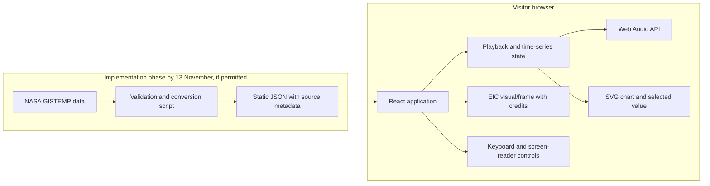

# The Earth Information Jukebox

> **An accessible, educational sonification experience for exploring NASA Earth observations.**
>
> **Working experience:** *Hear the Heat* — listen to global temperature anomalies while exploring the measurements and visualizations behind the sound.

**Project status:** Planning / documentation only  
**Challenge:** NASA Space Apps Challenge 2026 — “The Earth Information Jukebox”  
**Team:** 5 members  
**Team schedule:** Complete the build by 13 November; reserve 14–15 November for verification, testing, CI/CD, deployment, and demo/submission

> [!IMPORTANT]
> This repository currently contains project documentation, not a runnable application. No frontend, backend, sonification engine, or dataset has been implemented or validated yet. Stack, architecture, and feature plans in this README are recommendations until the team confirms them and builds them.

## Status legend

- ✅ **Confirmed:** a team direction or requirement already agreed upon.
- 📐 **Proposed:** a recommendation to validate before or during the hackathon.
- 🔲 **Planned:** intended work that is not implemented yet.
- ⚠️ **Needs validation:** a scientific, asset, or event detail to verify before making claims.

## Table of contents

1. [Overview](#1-overview)
2. [Challenge and project goals](#2-challenge-and-project-goals)
3. [Audience and user experience](#3-audience-and-user-experience)
4. [What the MVP includes](#4-what-the-mvp-includes)
5. [How the experience works](#5-how-the-experience-works)
6. [Data and scientific integrity](#6-data-and-scientific-integrity)
7. [Sonification design](#7-sonification-design)
8. [Accessibility](#8-accessibility)
9. [Recommended technology stack](#9-recommended-technology-stack)
10. [Proposed architecture](#10-proposed-architecture)
11. [Repository structure](#11-repository-structure)
12. [Development and setup status](#12-development-and-setup-status)
13. [Team roles and independent work plan](#13-team-roles-and-independent-work-plan)
14. [Schedule](#14-schedule)
15. [Demo flow](#15-demo-flow)
16. [Limitations and risks](#16-limitations-and-risks)
17. [Data, media, and attribution](#17-data-media-and-attribution)
18. [Reference links](#18-reference-links)
19. [Contributing](#19-contributing)
20. [Current status and next steps](#20-current-status-and-next-steps)

---

## 1. Overview

The Earth Information Jukebox is a proposed web experience that pairs Earth Information Center (EIC) visual material with sound generated from Earth observations. It is designed for students and other people seeking knowledge about Earth systems.

The first experience, **Hear the Heat**, focuses on global surface temperature anomalies. Visitors follow a guided story through a historical record, listen to data-driven tones, see the corresponding chart and EIC visualization, and inspect the value and explanation behind what they hear.

**Guiding idea:** Let people listen to changes in Earth data, explore the measurements, and understand why the sound changes.

### Why this project

Earth science is often communicated visually. Sonification can offer another way to engage with scientific information, including for people who do not access visualizations in the same way. It can also help learners notice changes across time. Audio is an additional way to explore the data; it does not replace the chart, text, labels, or scientific context.

---

## 2. Challenge and project goals

### Published challenge summary

The publicly indexed NASA Space Apps challenge summary asks for an interface, script, or application that pairs EIC visual frames with sonifications generated in real time.

We interpret **real-time generation** as producing sound dynamically during playback from selected observations. That does not necessarily mean the underlying measurements must be a live feed. This is an interpretation, not an official NASA clarification; check the complete challenge statement and its resources before finalizing the design.

### Project goals

- Make a working, understandable sonification experience.
- Pair the sound with a related EIC visual and the actual data.
- Let visitors inspect the year, measurement, units, source, and baseline.
- Make the same data and mapping reproducible.
- Provide controls and alternatives so audio is never required to understand the science.
- Finish one complete, polished data story before considering extra phenomena or features.

### Challenge requirement vs. team proposal

| Item | Status |
|---|---|
| Pair EIC visual frames with generated sonification | Challenge summary |
| Focus the first story on global temperature anomalies | Team recommendation |
| Use NASA GISTEMP v4 as the initial data candidate | Team recommendation; validate file and visual compatibility |
| Provide guided playback and compare two periods | Team UX choice |
| Generate tones in the browser | Proposed implementation choice |

---

## 3. Audience and user experience

### Primary audience

✅ Students and other people who want to learn about Earth observations and climate data.

### User experience principles

- Start with an immersive **“Listen to the Planet”** hero section.
- Offer a guided story first, with controls and details available as visitors continue.
- Keep introductory explanations short and plain-language; put deeper science in expandable details.
- Make the value and its source visible while the sound plays.
- Support comparison of two historical periods using the same dataset and scale.
- Do not autoplay audio.
- Keep the experience understandable when audio is off.

### Proposed visitor journey

1. **Arrive:** See the Earth hero, project purpose, and a clear **Listen now** action.
2. **Understand:** Read a brief explanation of a temperature anomaly and its reference baseline.
3. **Listen:** Start a guided playback synchronized with a temperature visualization and chart.
4. **Inspect:** See the selected year/value and open the explanation of the sound mapping.
5. **Compare:** Select two time periods and listen to each with the same mapping and scale.
6. **Continue without audio:** Explore the chart, table, labels, and text explanation instead.

---

## 4. What the MVP includes

### Core MVP — proposed

- One focused data story: global surface temperature anomalies.
- A NASA EIC temperature visualization or a carefully credited EIC frame/asset.
- A synchronized chart or timeline and playback position.
- Dynamic browser-generated sound from the selected measurements.
- Play, pause, restart, seek, and playback speed controls.
- Display of the current year, value, units, data source, and baseline.
- Optional comparison of two time periods.
- A plain-language **How the sound works** explanation.
- Keyboard support, readable text alternatives, and a data chart/table.

### Defer unless the core path is complete

- Additional Earth phenomena such as sea ice and ocean temperature.
- 3D globe or full GIS exploration.
- Live API updates, account systems, or a dedicated backend.
- AI-generated science explanations.
- Audio export and complex regional comparisons.

---

## 5. How the experience works

### Visitor-facing workflow



### Proposed data-to-sound workflow



### Playback behavior

- Playback advances through the chosen time series at a consistent interval.
- The chart cursor, selected year/value, visual frame (where available), and sound stay synchronized.
- Pausing stops progression without losing the current position.
- Seeking updates all representations to the selected position.
- Period A and Period B use the same mapping, scale, and playback settings for fair comparison.

These are planned behaviors; none are implemented yet.

---

## 6. Data and scientific integrity

### Candidate dataset: NASA GISTEMP v4

NASA’s GISS Surface Temperature Analysis (GISTEMP v4) estimates global surface temperature change and provides monthly anomaly data from 1880, including global series and gridded products. NASA updates its analysis approximately monthly.

- **Provider:** NASA Goddard Institute for Space Studies (GISS)
- **Candidate variable:** global land-ocean surface temperature anomaly
- **Candidate temporal resolution:** monthly; annual values may be derived if explicitly documented
- **Common GISTEMP baseline:** 1951–1980; confirm the exact selected file and metadata
- **Update cadence:** approximately monthly, not live
- **Source and documentation:** [NASA GISTEMP](https://data.giss.nasa.gov/gistemp/)

### Visual pairing must be checked

Candidate EIC and NASA visual sources:

- [EIC Global Temperature](https://earth.gov/sealevel/vital-signs/global-temperature/)
- [NASA SVS Global Temperature Anomalies](https://svs.gsfc.nasa.gov/5603/)
- [NASA GISS temperature animations](https://data.giss.nasa.gov/gistemp/animations/index.html)

Before claiming the visual shows the exact measurements being sonified, verify that its source, data version, baseline, time aggregation, smoothing, and time coverage match the app’s selected series. If they differ, state the difference clearly and use the EIC visual as contextual material rather than an exact frame-by-frame representation.

### Data validation checklist

- Record the exact dataset/file, version, variable, units, date range, baseline, and access date.
- Preserve source and creator credits.
- Confirm the chart and audio use the same values and aggregation.
- Document any derived values or transformations.
- Decide how missing/invalid observations appear in the chart and sound; silence must not be confused with zero.
- Keep observation dates and update cadence visible. Do not describe periodic data as live.
- Do not suggest a cause or relationship that the selected measurements do not establish.

---

## 7. Sonification design

### Candidate mapping — not yet validated

| Information | Candidate sound/UI behavior |
|---|---|
| Selected year or month | Playback position; advance at a regular interval |
| Temperature anomaly | Pitch relative to a documented reference pitch |
| Numeric anomaly | Also shown directly in text and on the chart |
| Period comparison | Listen to each period independently using the same mapping and scale |
| Missing observation | Explicitly mark as missing; do not encode as a zero anomaly |

The pitch range and reference pitch must be selected after inspecting the data range and listening to prototypes. The mapping should be fixed and documented, not adjusted to make one period sound more dramatic.

The supplied visual reference document also proposes using note-transition speed to encode rate of change. That is an optional idea for evaluation, not a confirmed mapping. For the MVP, avoid encoding the same measurement in both pitch and tempo unless user testing shows that it remains understandable.

### Explainability requirements

Visitors should be able to find:

- Which data value is sounding now.
- Which sound property that value controls.
- The mapping range and reference point.
- Units, baseline, time period, source, and update frequency.
- Any smoothing, normalization, or missing-data behavior.

---

## 8. Accessibility

Accessibility is a core product goal, not a later add-on.

- No automatic audio; visitors start playback themselves.
- All controls work by keyboard and have visible focus.
- Buttons and sliders have accessible names and playback-state announcements.
- Provide text for the selected year, value, units, and mapping explanation.
- Provide chart/table information as an alternative to listening.
- Do not communicate data through colour alone; include labels, values, or patterns.
- Use readable typography, strong contrast, and appropriately sized touch controls.
- Respect reduced-motion preferences and keep nonessential animation restrained.
- Keep a visible data cursor/selection synchronized with audio.
- Test with keyboard-only navigation and ask someone unfamiliar with the interface to complete the listening and comparison flows.

Reference guidance: [W3C keyboard accessibility](https://www.w3.org/WAI/WCAG22/Understanding/keyboard.html), [W3C ARIA slider pattern](https://www.w3.org/WAI/ARIA/apg/patterns/slider/), and [WCAG guidelines](https://www.w3.org/WAI/standards-guidelines/wcag/).

---

## 9. Recommended technology stack

The team has not selected a stack. The following is a **proposed target stack** for a responsive, browser-based MVP. Confirm it against the skills of the five members before the hackathon.

| Layer | Proposed technology | Role |
|---|---|---|
| Frontend | React + TypeScript + Vite | Build the landing page, guided story, player, and reusable controls |
| Styling | CSS, responsive layout, CSS custom properties | Visual system, responsive behavior, focus and reduced-motion states |
| Audio | Browser Web Audio API | Synthesize tones dynamically from the selected observations |
| Chart | SVG rendered in React | Draw a lightweight synchronized time series without requiring a server |
| Data preparation | Python 3.11 standard library or a small script in the chosen stack | Convert and validate the selected NASA source into a compact local JSON file |
| Runtime data | Static JSON shipped with the app | Keep the demo deterministic and reduce API/network dependencies |
| Backend/database | None for the MVP | Avoid service and deployment overhead unless a real requirement emerges |
| Hosting | Static hosting already familiar to the team | Publish the frontend; retain a local demo fallback |

This stack is a recommendation, not an as-built description. If the team has a familiar framework or hosting platform, prefer that over adding unfamiliar tools.

---

## 10. Proposed architecture



### Why no backend for version one?

The initial story can work from a small, versioned data file and generate sound locally in the browser. A server, database, login, or live API would add work without being necessary for the basic user experience. Add one only if the full challenge resources or an implemented feature requires it.

### Privacy and security direction

- Do not collect personal information for the MVP.
- No login or third-party tracking is planned.
- Keep all audio synthesis in the browser.
- Do not add API keys or credentials to frontend code or commit them to the repository.
- If analytics or external services are later proposed, document what is collected and why first.

---

## 11. Repository structure

### Current repository

```text
Nasa_hackathon/
├── README.md          # Project and technical overview
└── TEAM_BRIEF.md      # Team concept, UX, roles, and preparation brief
```

### Proposed structure after implementation

```text
Nasa_hackathon/
├── README.md
├── TEAM_BRIEF.md
├── package.json
├── index.html
├── public/
│   ├── data/
│   │   └── gistemp-global.json
│   └── assets/
│       └── README.md          # Asset credits and reuse notes
├── scripts/
│   └── prepare_data.py        # Optional source-data preparation
└── src/
    ├── App.tsx
    ├── main.tsx
    ├── styles/
    ├── components/
    ├── features/
    │   ├── playback/
    │   ├── sonification/
    │   ├── chart/
    │   └── comparison/
    └── data/
        └── loadObservations.ts
```

This is a proposal. Update the structure section when actual files are created.

---

## 12. Development and setup status

### Current setup status

There is no application code or package manifest in the repository yet. The commands below are **not runnable at this stage**; they describe the likely setup after the React/Vite stack is confirmed and added.

### Planned local setup

```bash
# Clone the repository
git clone https://github.com/isharpals-06/Nasa_hackathon.git
cd Nasa_hackathon

# After package.json is added:
npm install
npm run dev
```

The exact supported Node.js version and scripts must be documented in `package.json` once the app is implemented. A production build command and deployment instructions should be added then.

### Verification status

No app tests, data validation, browser playback checks, or accessibility checks have been run because the app does not exist yet. Do not describe the proposed features as tested or implemented until they are.

---

## 13. Team roles and independent work plan

The five workstreams below are designed to proceed in parallel after the team agrees on the shared interfaces. Each person owns a distinct output so teammates can build, review, and hand off work without waiting for another feature to be finished.

### Shared setup and working agreement

1. One integrator creates the app scaffold and commits the shared TypeScript interfaces first.
2. Each workstream starts from that scaffold on its own branch and owns the files listed below.
3. If a task needs a shared interface changed, propose the change before editing another owner’s files.
4. Merge small pull requests into the integration branch; the integrator resolves conflicts and connects the modules.
5. Each owner provides a short handoff: what is ready, how to use it, any assumptions, and what remains.

Suggested branch names: `feature/app-shell`, `feature/data`, `feature/audio`, `feature/chart`, and `feature/content-a11y`.

### Parallel task assignments

| Member | Independent task | Owns these outputs | Handoff |
|---|---|---|---|
| 1. Frontend / integration | Create the React/Vite shell, shared TypeScript interfaces, hero, page layout, and module integration | `src/App.tsx`, `src/components/HeroSection.tsx`, `src/data/types.ts`, `src/styles/` | Running page shell, shared data types, and clearly marked slots for player, chart, and explanatory text |
| 2. Data / science | Select and validate the GISTEMP global series; prepare the local data file and provenance notes | `src/data/loadObservations.ts`, `public/data/gistemp-global.json`, `docs/data-notes.md` | Data file matching the shared types, plus exact source/version/units/baseline/date notes |
| 3. Audio / interaction | Build the pure value-to-pitch mapping and browser audio controller; handle start/stop and cleanup | `src/features/audio/sonification.ts`, `src/features/audio/audioController.ts` | Functions matching the audio contract below, with mapping limits documented and held constant across comparisons |
| 4. Visualization | Build the responsive SVG temperature chart/timeline and period comparison selectors | `src/features/chart/TemperatureChart.tsx`, `src/features/chart/PeriodComparison.tsx`, `src/features/chart/chart.css` | Components matching the chart contract below; selecting a point reports its index to the parent |
| 5. Content / accessibility / demo | Prepare concise science copy, interaction/accessibility review checklist, asset credits, and demo script | `src/content/copy.ts`, `docs/accessibility-checklist.md`, `docs/asset-credits.md`, `docs/demo-script.md` | Ready-to-use approved copy and checklists; no uncredited images or unsupported science claims |

Role labels are recommendations; assign them to match each member’s strengths. The outputs remain separated by owner even if another member helps.

### Shared data contract

The data owner and UI owners should use this shape so the chart and audio modules can be built independently:

```ts
export type Observation = {
  /** ISO year-month, for example "2020-01". */
  period: string;
  /** Temperature anomaly in degrees Celsius; null means missing, never zero. */
  anomalyC: number | null;
};

export type TemperatureDataset = {
  metadata: {
    title: string;
    sourceUrl: string;
    accessedDate: string;
    variable: string;
    units: "°C";
    baseline: string;
    temporalResolution: "monthly" | "annual";
    startPeriod: string;
    endPeriod: string;
    updateCadence: string;
    notes: string[];
  };
  observations: Observation[];
};
```

The actual selected NASA file may require a documented conversion before it matches this contract. Do not silently change its units, baseline, aggregation, or missing values.

### Shared component and audio contracts

- `TemperatureChart` receives `{ observations: Observation[], selectedIndex: number, onSelectIndex: (index: number) => void, label: string }`. It renders data and selection only; it does not own audio playback.
- `PeriodComparison` receives `{ availablePeriods: string[], periodA: string, periodB: string, onSelectPeriodA: (period: string) => void, onSelectPeriodB: (period: string) => void }` and reports selections to the parent.
- `PitchScale` contains `{ minAnomalyC, maxAnomalyC, minHz, maxHz }`, with one validated, fixed scale for both comparison periods.
- `anomalyToFrequency(anomalyC: number | null, scale: PitchScale): number | null` is deterministic, returns a frequency in hertz, and returns `null` for a missing value.
- `createAudioController(scale)` returns `{ playValue(anomalyC: number | null, durationMs: number): void, stop(): void, dispose(): void }`. The app owns playback timing; the controller creates and stops tones.
- `App` owns the shared selected index, play state, selected comparison periods, and coordination between chart and audio.

The integrator should accept interface changes only after the affected owners agree, so work remains easy to combine.

### Definition of done for each workstream

- The output exists in the agreed files and follows the shared contracts.
- Source, units, baseline, and asset credits are included wherever relevant.
- Empty, missing, and error states are described rather than silently hidden.
- The owner adds a short README/PR handoff with assumptions and remaining work.
- After integration, the team checks the complete path in the browser and reviews keyboard access and the demo flow.

### Independent verification owners for 14–15 November

| Member | Verification / release responsibility |
|---|---|
| 1. Frontend / integration | Confirm CI workflow, production build, deployed URL, and end-to-end smoke check |
| 2. Data / science | Check labels, units, dates, baseline, missing values, and source attribution against the chosen NASA file |
| 3. Audio / interaction | Check playback start/stop, seeking, comparison consistency, and browser audio behavior |
| 4. Visualization | Check chart selection, comparison periods, responsive layout, and synchronization |
| 5. Content / accessibility / demo | Check keyboard and screen-reader experience, text alternatives, asset credits, and demo/submission narrative |
A separate backend service is not expected for the proposed MVP. All members should be able to explain the selected dataset and how it relates to the sound.

---

## 14. Schedule

### By 13 November — implementation complete (team target)

- Complete the app’s core user journey: hero → guided story → synchronized data/chart/audio → period comparison.
- Prepare the selected NASA data and document units, baseline, dates, and source.
- Implement the proposed audio mapping and visible explanation.
- Complete the essential accessibility and responsive UI work.
- Freeze feature scope and produce a build that is ready for final verification.

### 14–15 November — verification and release

1. Verify the complete user journey and all data labels against the selected source.
2. Run functional, browser, responsive, keyboard, and screen-reader checks.
3. Set up or confirm CI checks and production build workflow.
4. Deploy the app, verify the deployed version, and keep a local/recorded demo fallback.
5. Finalize the project page and demo submission before the official deadline.

> **Event-rule assumption to confirm:** This is the team’s intended schedule, not a statement of NASA rules. NASA lists the global event for 14–15 November ([official schedule](https://www.spaceappschallenge.org/2026/)). The [public Kopargaon listing](https://unstop.com/college-fests/nasas-space-apps-challenge-kopargoan-nasa-space-app-challenge-foundation-507854/amp) does not specify whether challenge-specific implementation may begin before the event. Another 2026 local event’s [published instructions](https://www.spaceappschallenge.org/2026/local-events/faisalabad/) explicitly say to begin building on November 14. Confirm the pre-event build plan with the Kopargaon organizer and current participant guidance before treating it as approved. If pre-event implementation is not allowed, use the 7–13 November period for general tool practice, data familiarization, and planning, then move the build work into the event window.

---

## 15. Demo flow

A short demonstration can show:

1. The **Listen to the Planet** hero and the learning goal.
2. The EIC temperature visual and the meaning of anomaly/baseline.
3. Press **Listen now** and follow one selected year/value in the chart and sound.
4. Pause and open **How the sound works**.
5. Compare two time periods using the same scale.
6. Show keyboard controls and the chart/table alternative.
7. End with data source, update cadence, and attribution.

---

## 16. Limitations and risks

| Risk or limitation | Response |
|---|---|
| EIC visual and chosen GISTEMP series may differ in baseline, smoothing, or aggregation | Validate metadata; label the relationship precisely; never claim exact pairing if it is not exact |
| Sonification could sound expressive but confuse data meaning | Keep one simple, fixed mapping and display numeric values alongside audio |
| GISTEMP is periodic, not real-time | State the observed period and update cadence clearly |
| Large scope can exceed a two-day build | Finish one focused story before adding phenomena or 3D exploration |
| Browser/device may not support sound as expected | Provide chart/table/text and a reliable demo fallback |
| Visual media reuse may have additional credits/conditions | Verify the individual asset page and preserve all creator credits |
| Sonification does not make a dataset inherently accessible | Provide accessible controls and equivalent non-audio information; involve users in review |
| The mapping is an authored representation | Document it, keep it reproducible, and do not present it as NASA’s own mapping |

---

## 17. Data, media, and attribution

The included links are references, not blanket permission to download or reuse every asset. Before adding media:

1. Record the title, creator, source page, and exact asset URL.
2. Read the specific page’s credit and reuse terms, including third-party material.
3. Preserve required agency, photographer, and visualization credits.
4. Keep data units, baseline, dates, and caveats visible in the interface.
5. Do not imply NASA or NOAA endorsement of the project.

NASA media guidance: [NASA Images and Media](https://www.nasa.gov/nasa-brand-center/images-and-media/). NASA data and visualizations can have asset-specific credits and conditions.

---

## 18. Reference links

### Earth imagery and EIC visuals

- [NASA Blue Marble](https://visibleearth.nasa.gov/collection/1484/blue-marble)
- [NASA Eyes on the Earth](https://eyes.nasa.gov/apps/earth/)
- [NASA Earth Observatory](https://earthobservatory.nasa.gov/)
- [NASA Image and Video Library](https://images.nasa.gov/)
- [Earth.gov Global Temperature](https://earth.gov/sealevel/vital-signs/global-temperature/)

### Temperature data and visualizations

- [NASA GISTEMP v4](https://data.giss.nasa.gov/gistemp/)
- [NASA Global Temperature Anomalies 1880–2025 (SVS)](https://svs.gsfc.nasa.gov/5603/)
- [NASA GISS Temperature Animations](https://data.giss.nasa.gov/gistemp/animations/index.html)
- [NASA Climate Spiral](https://svs.gsfc.nasa.gov/5190/)
- [Our World in Data Temperature Anomaly chart](https://ourworldindata.org/grapher/temperature-anomaly)

### Sonification and accessibility

- [NASA Data Sonifications](https://www.nasa.gov/data-sonifications/)
- [NASA Chandra Sonification](https://chandra.si.edu/sound/)
- [W3C Keyboard Accessibility](https://www.w3.org/WAI/WCAG22/Understanding/keyboard.html)
- [W3C ARIA Slider Pattern](https://www.w3.org/WAI/ARIA/apg/patterns/slider/)
- [W3C WCAG Guidelines](https://www.w3.org/WAI/standards-guidelines/wcag/)
- [W3C Media Accessibility Requirements](https://www.w3.org/TR/media-accessibility-reqs/)

---

## 19. Contributing

During implementation and release, keep changes focused on the agreed MVP. When adding a feature or changing the data mapping:

- State whether it is implemented, proposed, or experimental.
- Keep NASA challenge requirements separate from team design decisions.
- Record dataset changes, units, baseline, and visualization compatibility.
- Update this README when the actual stack, routes, setup, architecture, or implementation status changes.
- Do not claim a feature is complete or accessible until it has been exercised in the application.

---

## 20. Current status and next steps

### Current status

- ✅ Team direction and UX preferences captured in [`TEAM_BRIEF.md`](./TEAM_BRIEF.md).
- ✅ Visual reference links collected.
- 🔲 App implementation not started.
- 🔲 GISTEMP file and exact visual pairing not validated.
- 🔲 Technology stack not yet confirmed by the team.
- 🔲 Sonification mapping not tested with users.

### Next steps

1. Read the complete challenge statement and resource list.
2. Confirm the Kopargaon event start rules.
3. Confirm whether the proposed React/Vite/Web Audio stack fits the team.
4. Select and validate the exact NASA dataset and EIC visual.
5. Agree on the mapping and one MVP flow before building.

---

*This README describes the current project plan, not an implemented application. Update it as the team makes decisions and the repository changes.*


